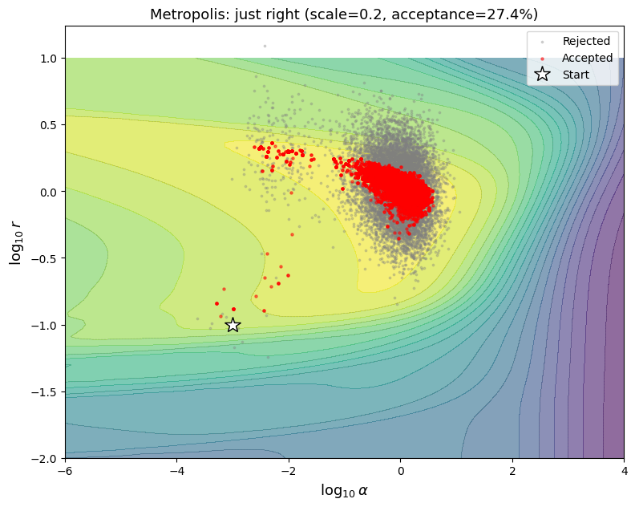
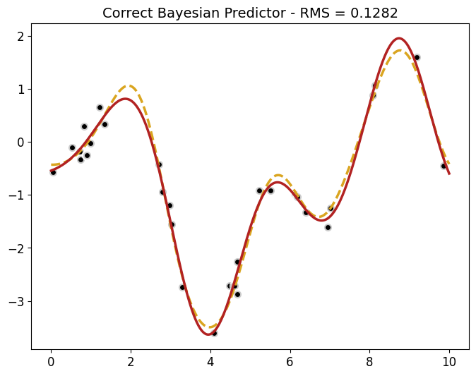
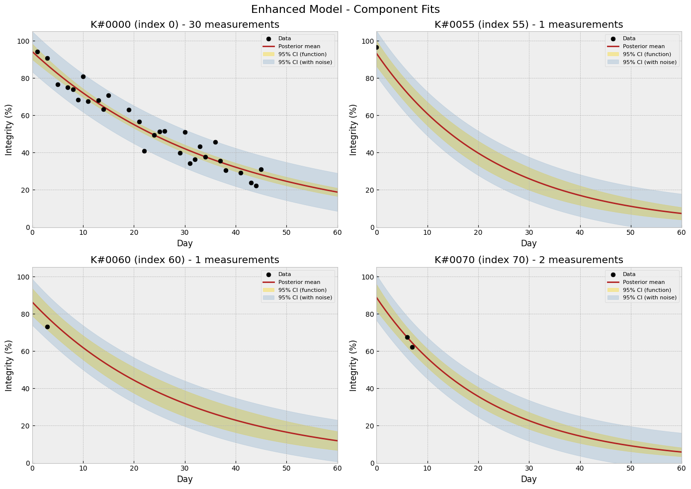
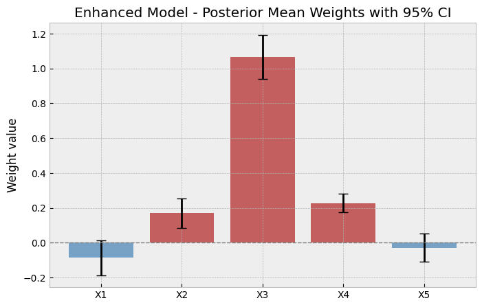

# Bayesian Inference in Practice: MCMC & Hierarchical Degradation Modelling

Two end-to-end Bayesian modelling projects built on the same toolkit (MCMC, HMC/NUTS and probabilistic programming in `numpyro`):

1. **MCMC from scratch.** A Metropolis sampler written in NumPy/SciPy and compared with HMC/NUTS on Bayesian regression with Gaussian RBF basis functions.
2. **Hierarchical degradation modelling.** Partial-pooling models that predict when mechanical components fall below a safe integrity level, even with only one or two measurements per component.

---

## 1. MCMC from scratch: Metropolis vs. HMC/NUTS

**Notebook:** [`notebooks/01_metropolis_and_nuts_regression.ipynb`](notebooks/01_metropolis_and_nuts_regression.ipynb)

A noisy 1-D regression problem (30 training points, 1,000 noise-free test points) is modelled with a Bayesian linear-in-the-parameters model: 29 Gaussian RBFs plus a bias, a Gaussian weight prior with precision α, noise level σ, and a shared basis width r. The unknowns are the hyperparameters (α, r, σ) and the 30 weights.

What the notebook does:

- **Hyperparameter posterior.** Computes p(α, r | y) on a log-spaced grid from the analytic marginal likelihood (with uniform priors on the log scale), and locates its maximum.
- **Metropolis sampler from scratch.** About 20 lines, with a study of proposal scale: too narrow (random-walks), too broad (rejects almost everything) and well-tuned (~27% acceptance).
- **Growing the state space.** The sampler is extended to include σ (3-D), then *all* unknowns including the weights (33-D).
- **HMC/NUTS in `numpyro`.** The same model as a probabilistic program, with `arviz` diagnostics (R-hat, effective sample size, trace plots).
- **Two predictors.** A cheap "pragmatic" plug-in predictor and a fully Bayesian one that integrates over r.

| Sampler | Quantity | Estimate | True value |
|---|---|---|---|
| Metropolis, scale 0.02 (too narrow) | acceptance rate / ⟨r⟩ | 87% / 1.081 | r = 1.0 |
| Metropolis, scale 3.0 (too broad) | acceptance rate / ⟨r⟩ | 0.4% / 1.067 | r = 1.0 |
| Metropolis, scale 0.2 (well-tuned) | acceptance rate / ⟨r⟩ | 27.4% / 1.092 | r = 1.0 |
| Metropolis, 3-D (adds σ) | ⟨σ⟩ | 0.232 | σ = 0.2 |
| Metropolis, 33-D (all unknowns) | ⟨σ⟩ | 0.209 | σ = 0.2 |
| NUTS | r / σ / α | 1.047 / 0.228 / 0.983 | r = 1.0, σ = 0.2 |

**Predictive accuracy (RMS error against the true function):** pragmatic plug-in predictor **0.177**, fully Bayesian predictor **0.128**. Integrating over r instead of plugging in a point estimate gives a clearly better predictor.

<p align="center">
  
  
</p>

---

## 2. Hierarchical Bayesian modelling of component degradation

**Notebooks:** [`notebooks/02_hierarchical_degradation_model.ipynb`](notebooks/02_hierarchical_degradation_model.ipynb) (modelling) and [`notebooks/03_deployable_predictor.ipynb`](notebooks/03_deployable_predictor.ipynb) (deployable predictor)
**Report:** [`docs/component_degradation_report.pdf`](docs/component_degradation_report.pdf)

### The problem

Mechanical component *K* loses integrity (0-100%) over time. There are 879 irregular measurements across 75 components, recorded for up to 45 days. The 25 most recently commissioned components have very sparse histories (mean 3.0 measurements, some with one), and each component also has five fixed physical characteristics, X1-X5. The aim is to predict degradation reliably despite the sparse data, find out which characteristics matter, and provide something deployable.

### Models

Both models use a hierarchical (partially pooled) exponential-decay form with a non-centred parameterisation, fitted with NUTS (4 chains × 2,000 samples, 2,000 warm-up each):

| | Model | Form |
|---|---|---|
| Baseline | per-component initial integrity and decay rate | f<sub>i</sub>(t) = u<sub>i</sub> · exp(−v<sub>i</sub> · t / 100) |
| Enhanced | adds shared weights on the component characteristics | f<sub>i</sub>(t) = u<sub>i</sub> · exp(−(v<sub>i</sub> + Σ<sub>j</sub> w<sub>j</sub> x<sub>ji</sub>) · t / 100) |

Here u<sub>i</sub> ~ N(μ<sub>u</sub>, σ<sub>u</sub>) and v<sub>i</sub> ~ N(μ<sub>v</sub>, σ<sub>v</sub>), with observations y<sub>i</sub>(t) ~ N(f<sub>i</sub>(t), σ<sub>y</sub>²). Components share information through the hyperparameters, so sparse components are pulled toward the population rather than fitted in isolation.

### Key findings

- **Sampling was healthy.** Zero divergences and R-hat = 1.00 for all parameters in both models.
- **Characteristics explain most of the variation in decay rate.** Adding X1-X5 cut the between-component spread of decay rates (σ<sub>v</sub>) from 1.59 to 0.35 (**−78%**), while the noise estimate σ<sub>y</sub> stayed at about 5.1%. The weights are picking up real structure, not just soaking up noise.
- **X3 dominates.** Posterior mean weight +1.07 with essentially all posterior mass above zero. X4 (+0.23) and X2 (+0.17) are smaller but clear. X1 and X5 show no meaningful effect.
- **Blind-test predictions.** For components 50-74, the probability that integrity is ≤ 30% at day 30 is estimated directly from the posterior samples ([`results/predictions.csv`](results/predictions.csv)). Predictions span the whole 0-1 range, driven by X3 and the learned decay rates.
- **Deployable predictor.** Posterior samples are saved to `results/model_samples.npz`. `03_deployable_predictor.ipynb` loads them and predicts the mean and uncertainty of integrity for any component and time using only NumPy, with no sampler needed.

<p align="center">
  
  
</p>

### Known limitations (discussed in the report)

The exponential form and the linear effect of X1-X5 on the decay exponent are assumptions; Gaussian noise may be sensitive to outliers (a Student-t likelihood would be more robust); and the model assumes a homogeneous population. Suggested next steps are posterior predictive checks, non-linear effects for X3, and periodic refitting as new data arrive.

---

## Repository structure

```
.
├── notebooks/
│   ├── 01_metropolis_and_nuts_regression.ipynb   # Metropolis from scratch + HMC/NUTS
│   ├── 02_hierarchical_degradation_model.ipynb   # baseline & enhanced hierarchical models
│   └── 03_deployable_predictor.ipynb             # NumPy-only predictor from saved samples
├── src/
│   └── bayes_utils.py                            # data generation, RBF basis, marginal likelihood, plotting
├── data/
│   └── bml-component-data.csv                    # component measurements (879 rows, 75 components)
├── results/
│   ├── predictions.csv                           # P(integrity ≤ 30% at day 30), components 50-74
│   └── model_samples.npz                         # posterior samples for the deployable model
├── docs/
│   ├── component_degradation_report.pdf          # full write-up of the degradation project
│   └── figures/
├── requirements.txt
└── README.md
```

## Getting started

```bash
git clone <this-repo-url>
cd <repo-folder>

python -m venv .venv && source .venv/bin/activate    # optional
pip install -r requirements.txt

cd notebooks
jupyter notebook
```

Run the notebooks from inside `notebooks/` (they use relative paths to `../src`, `../data` and `../results`). Notebook 03 only needs `results/model_samples.npz`, which is included, so it runs without re-fitting. Re-running notebook 02 regenerates the samples, predictions and figures; the full fit takes a few minutes on a laptop CPU.

NUTS results can differ slightly between library versions (for example, the RMS errors above come from the saved notebook outputs; a fresh re-run with newer `jax`/`numpyro` gave 0.169 and 0.126), whereas the Metropolis results reproduce exactly because the seeds are fixed.

The optional model-diagram cell in notebook 01 needs [Graphviz](https://graphviz.org/download/) (system executables plus `pip install graphviz`) and is skipped gracefully otherwise.

## Tech stack

Python · NumPy · SciPy · JAX · NumPyro · ArviZ · pandas · Matplotlib · Seaborn
